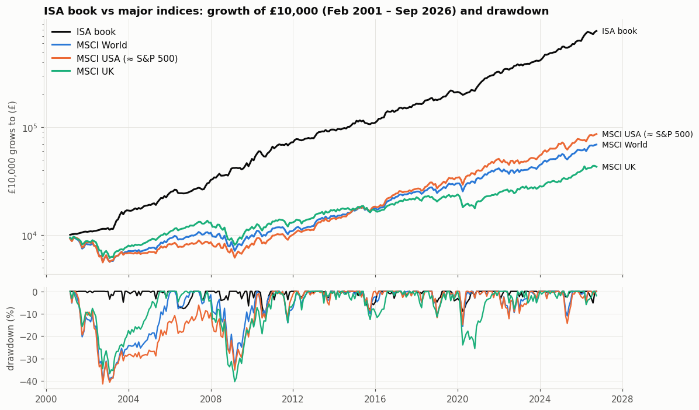

# Quantitative Trading Portfolio

Quantitative finance projects written in Python, grouped by the market they trade. Assumptions, results and limitations live in the individual project READMEs rather than here.

## Layout

| Folder | Contents |
| --- | --- |
| [`original_portfolio/`](./original_portfolio/) | Nine projects on US equities, running from market statistics through to the paper trading bot |
| [`isa_portfolio/`](./isa_portfolio/) | The ISA system. A long-only book of primarily ETFs being held in a UK Stocks and Shares ISA. Paper trading commenced November 2026. Showcasing pieces available [here](./isa_portfolio/isa_showcase/) |
| [`crypto_portfolio/`](./crypto_portfolio/) | Crypto research. A crypto trading system much like the ISA system is in progress|
| [`archive/strategies/`](./archive/strategies/) | Retired UK and crypto experiments, kept read-only with their READMEs, notebooks and code. Retired sleeves from the ISA system to be shown when written up |
| [`foundation/`](./foundation/) | Shared, imported library used by project across the portfolio |

## Method

Later projects follow a similar pattern. A rule/strategy is chosen based off of an economic hypothesis. Development and holdout periods are fixed, with the holdout period preserved entirely for testing the strategy developed. Transaction costs are modelled, with fees only being charged on net assets traded. All strategies are compared with a suitable benchmark, with HAC testing, block bootstrapping, or both to test whether there is a statistical edge to our strategy. Equity curves are calculated and plotted, with a variety of risk management approaches being tested to see if there is positive effects.

Strategies that are not useful are kept for research purposes, but not implemented in practice.

## ISA portfolio

The long-only, ISA-designed system for holding assets in a UK Stocks and Shares ISA. The long-only constraint is due to leverage trading, derivative trading or shorting not being allowed inside a Stocks and Shares ISA. The current chosen broker is Trading 212, with paper trading beginning at the start of November 2026.  The system contains five primary parts:

- [Core](./isa_portfolio/isa_showcase/core/): An ETF only core, held 100% of time outside of a defensive/rebound period
- [Defensive Basket](./isa_portfolio/isa_showcase/defensive): The defensive basket designed for recessions, alongside an exit/re-entry market recession trigger
- [Rebound Basket](./isa_portfolio/isa_showcase/rebound): A basket designed for best performance in the recovery period after a recession
- [Sleeves](./isa_portfolio/isa_showcase/sleeves): Assets that are held under certain market conditions. Funding for such holdings is from the core
- [Overlays](./isa_portfolio/isa_showcase/overlay): Assets that are held under certain market conditions, at month-endings.

All five of the above layers are combined in the [Allocator](./isa_portfolio/isa_showcase/allocator), which assigns different weights to each layer using portfolio optimisation techniques. 

Backtested, begin in February 2001 with £10,000, end in September 2026. The book is after modelled costs, with the indices not including fund fees.

| | CAGR | Sharpe | max drawdown | £10,000 becomes |
|---|---|---|---|---|
| ISA book | 18.5% | 1.53 | −10.6% | £778,600 |
| MSCI World | 7.8% | 0.45 | −39.9% | £68,900 |
| MSCI USA (≈ S&P 500) | 8.8% | 0.49 | −41.4% | £86,300 |
| MSCI UK | 5.8% | 0.32 | −40.3% | £42,900 |

The live system engineering is currently kept private, as are specific basket holdings.

### Limitations

- Core ETFs history begins in 2010, so before that index data was used.
- The backtest is in-sample, so true performance depends on its forward live performance
- Some assets used had a bull period since 2000, so their corresponding sleeves may not hold up if they were to have a bear period

[View showcase](./isa_portfolio/isa_showcase/)

Earlier 'UK_portfolio' research projects, including reversal signals, ETF trend and equity momentum, are in [`archive/strategies/`](./archive/strategies/).

## Crypto portfolio

Research concerning cryptocurrencies, with transaction costs based upon Revolut X offerings.

### Crypto momentum 

Weekly absolute momentum on BTC, ETH against GBP. Each asset is held while its trailing 30d returns are positive, with cash being held otherwise. Over the 2024-2025 holdout, returned 96.50% after modelled transaction costs. Bootstrap confidence intervals include 0, so no statistically significant edge shown comparitively to its benchmark. Limited by only having a 2 asset universe, 2 year holdout and untested trading frequency.

[View project](./crypto_portfolio/crypto_momentum/)

Older, rejected crypto projects still remain available in [`archive/strategies/`](./archive/strategies/).

There is a crpyto trading system analogous to the ISA system in the works, with M0 working as the 'core', with planned Revolut X use. Research has begun on looking for patterns in the same way, and seeking for market patterns whose edges beat transaction costs, aiming to diversify the current holdings.

## Original portfolio

Begin with building up quantitative finance and machine learning knowledge across various topics to be used later. From project 7 onwards, signal testing and risk management approaches were tested. Technical indicators showed no significance, with machine learning not adding anything. A momentum effect held up, but only on a subset of the market, and dissappeared when expanded to the full S&P500, so universe limited to that subset. Risk management strategies were tried, but all underperformed the equity curve significantly, so none were implemented.

As a result, the trading bot enacts the 63d momentum approach on the smaller universe through Alpaca paper trading. Execution is daily through cron, but rebalancing only occurs every 21 trading days.

### 1. Past market analysis
Historical price analysis, return important statistics, and multi-asset Sharpe ratio ranking across stocks, ETFs, and cryptocurrencies.

[View project](./original_portfolio/past_market_analysis/)

### 2. Technical analysis, signal generation and backtesting
Adaptive RSI, Bollinger thresholds, ADX-weighted composite trading signals and backtesting across various tickers

[View project](./original_portfolio/technical_analysis/)

### 3. Options pricing, stochastic modelling and implied volatility
Black-Scholes analytical pricing with SymPy, Monte Carlo simulation with SciPy, and implied volatility calculations.

[View project](./original_portfolio/options_pricing/)

### 4. Time series forecasting
ARIMA return modelling and GARCH/GJR volatility forecasting, with walk-forward backtesting and comparison against market implied volatility.

[View project](./original_portfolio/time_series_forecasting/)

### 5. Portfolio construction
Efficient frontier plotting for both long-only, short-allowed portfolios, alongside out-of-sample testing for max-Sharpe, min-variance and risk parity portfolios.

[View project](./original_portfolio/portfolio_construction/)

### 6. Machine learning fundamentals
Overfitting, feature importance, calibration and cross validation, established on well-behaved data before being applied to anything financial.

[View project](./original_portfolio/ml_fundamentals/)

### 7. Machine learning trading signals and momentum validation
Rigorous validation of ML on technical indicators, which found no significance, followed by a cross-sectional momentum signal that did hold up and that ML could not improve on. Ends with a forward-looking test of value and quality fundamentals.

[View project](./original_portfolio/ml_trading_signals/)

### 8. Risk management and position sizing
Kelly optimised, volatility scaled and CVaR-constrained sizing applied to the momentum signal. All four risk mechanisms came up short of the unadjusted strategy.

[View project](./original_portfolio/risk_management/)

### 9. Autonomous trading system
Automated execution of the universe and momentum signal from project 7, on Alpaca paper trading, run daily by cron, with a weekly summary after each simulated run.

[View project](./original_portfolio/trading_bot/)

## Libraries

Python, NumPy, pandas, Matplotlib, SciPy, SymPy, statsmodels, arch, scikit-learn, yfinance,
pandas_market_calendars, alpaca-py.

## About

Trading Portfolio built by Oscar Lewis, 4th year MMath student at the University of Warwick, to showcase skills in python, quantative finance, stochastic calculus and machine learning. For key details on individual projects see README's.

[LinkedIn](https://www.linkedin.com/in/oscar-lewis-aba333230) · [GitHub](https://github.com/oscar-lewis-3333)
